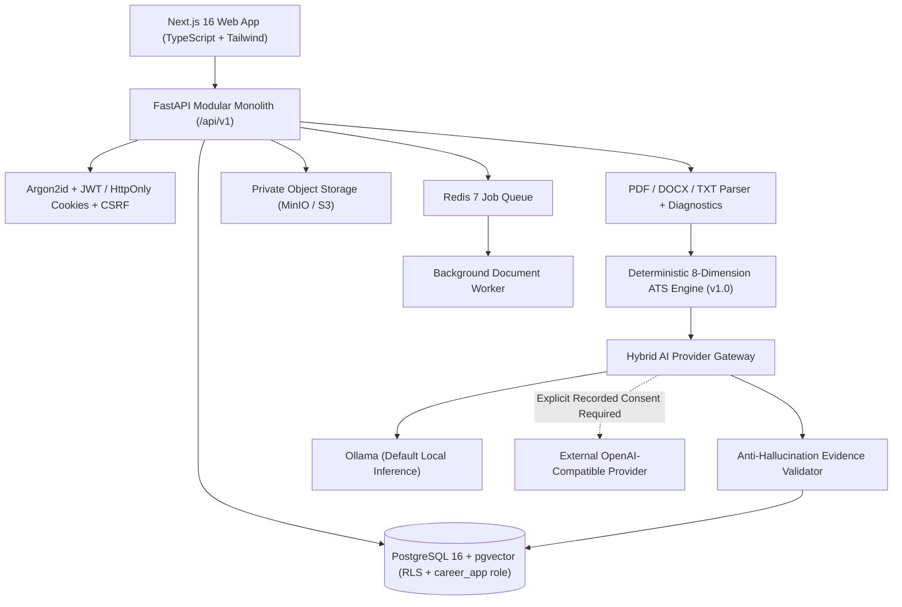

<div align="center">

# CareerIntel — ATS Optimization & Career Intelligence Platform

**A free, open-source, privacy-first career intelligence platform for resume analysis, job-description matching, evidence-backed optimization, cover-letter generation, career development, and application tracking.**

[](https://github.com/AnandBinuArjun/career-intelligence-platform/actions/workflows/ci.yml)
[](LICENSE)
[](apps/api/pyproject.toml)
[](apps/api)
[](apps/web)
[](apps/web)
[](apps/api/migrations)
[](#core-principles)
[](https://github.com/AnandBinuArjun)
[](https://abarjun.online)

</div>

---

> **Transparency & Ethics Notice:** CareerIntel does **not** claim to bypass applicant tracking systems, reproduce proprietary ATS vendor algorithms, or guarantee interviews. All compatibility scores are transparent, reproducible **platform estimates** backed by traceable document evidence — never hallucinated skills, dates, or credentials.

## Table of Contents

- [Core Principles](#core-principles)
- [Platform Modules](#platform-modules)
- [System Architecture](#system-architecture)
- [Technology Stack](#technology-stack)
- [Quick Start](#quick-start)
- [Project Structure](#project-structure)
- [Security & Privacy by Design](#security--privacy-by-design)
- [Testing & Quality Checks](#testing--quality-checks)
- [Documentation](#documentation)
- [Contributing](#contributing)
- [License](#license)

---

## Core Principles

1. **Evidence Before Generation** — Every AI-assisted rewrite or cover-letter claim must map to candidate-provided evidence or be explicitly flagged for user confirmation. Verified profile data is never silently mutated.
2. **Transparent, Deterministic Scoring** — Compatibility scores are calculated deterministically (`v1.0`) across 8 dimensions with configurable weights and mandatory-qualification guardrails — separate from generative AI.
3. **Privacy-First & Local-First AI** — Local Ollama inference is the default. External AI providers are disabled unless explicitly configured **and** backed by a recorded, purpose-specific user consent record.
4. **100% Free Forever** — No paywalls, no watermarked exports, no selling or monetizing candidate CV data. Supports both hosted and self-hosted Docker deployments.

---

## Platform Modules

| # | Module | Web Route | Capabilities |
|---|---|---|---|
| **01** | **Overview Dashboard** | `/` | Workspace KPIs, profile completeness, guided onboarding checklist, recent compatibility reports, pipeline snapshot, and visible AI privacy indicator. |
| **02** | **My Resumes** | `/resumes` | Validated private PDF/DOCX/TXT upload, text/section extraction & ATS readability diagnostics, structured editor, immutable version history + snapshot restore, and clean single-column PDF/DOCX export. |
| **03** | **ATS Compatibility Engine** | `/analyzer` | Configurable weighted scoring across 8 dimensions (parsing, formatting, keyword coverage, skills alignment, experience evidence, education/certs, achievement clarity, completeness), requirement-by-requirement evidence matrix, and Optimization Review with accept/reject guardrails. |
| **04** | **Job Intelligence** | `/jobs` | Job-description parsing separating explicit required vs. preferred skills, certifications, education, and responsibilities, with inline requirement editing before scoring. |
| **05** | **Cover Letter Studio** | `/cover-letters` | Evidence-grounded cover letter drafting tied to a resume version and job description, tone & length controls, evidence citations panel, versioned editing, and PDF/DOCX/TXT export. |
| **06** | **Career Development** | `/career` | Aggregated skill-gap ranking across analyzed jobs, verifiable learning plans, and tailored STAR interview questions anchored to candidate evidence. |
| **07** | **Application Tracker** | `/applications` | Kanban board & list view across 9 statuses (`draft` → `ready` → `applied` → `screening` → `interview` → `assessment` → `offer` / `rejected` / `withdrawn`) plus interview records logging. |
| **08** | **Settings, Profile & Privacy** | `/settings` | Verified Candidate Profile (source of truth), AI routing & consent history/withdrawal, configurable retention period, security audit log viewer, portable JSON data export, and cascading account + private file deletion. |

---

## System Architecture



The backend is intentionally designed as a **modular monolith** with a separate worker entry point (`apps/api/app/workers/worker.py`) — keeping self-hosting simple while maintaining strict domain boundaries.

---

## Technology Stack

| Layer | Technologies |
|---|---|
| **Frontend** | Next.js 16 (App Router), React 19, TypeScript 5.7, Tailwind CSS 3.4, Lucide React |
| **Backend API** | Python 3.12+, FastAPI, Pydantic Settings, SQLAlchemy 2.0, Argon2id (`argon2-cffi`), PyJWT |
| **Document Processing** | `pypdf`, `python-docx`, `fpdf2` (watermark-free selectable-text PDF & DOCX export) |
| **Database & Storage** | PostgreSQL 16 + `pgvector` (with SQLite support for zero-Docker local dev/tests), S3 / MinIO (`boto3`), Redis 7 |
| **AI & Intelligence** | Deterministic skills taxonomy & 8-dimension scoring engine, Ollama local provider, consent-gated OpenAI-compatible adapter |
| **CI & Tooling** | GitHub Actions, `ruff`, `mypy`, `pytest`, ESLint 9, Docker Compose |

---

## Quick Start

### Prerequisites

- **Python 3.12+**
- **Node.js 22+ LTS**
- **Docker & Docker Compose** *(optional — required for Option A; not needed for Option B)*

---

### Option A: Full Stack with Docker Infrastructure (Recommended for Self-Hosting)

1. **Clone and configure environment:**
   ```bash
   git clone https://github.com/AnandBinuArjun/career-intelligence-platform.git
   cd career-intelligence-platform
   cp .env.example .env
   ```
   > Replace all placeholder secrets in `.env` (generate keys with `openssl rand -hex 32`) before exposing any service.

2. **Start PostgreSQL, Redis, MinIO (and optionally Ollama):**
   ```bash
   docker compose up -d postgres redis minio
   # Optional local LLM inference:
   docker compose --profile local-ai up -d ollama
   ```

3. **Apply versioned database migrations in order (as PostgreSQL administrator):**
   ```bash
   make migrate
   ```
   *(The API connects using the restricted `career_app` role created automatically by `infrastructure/postgres/init/001-create-app-role.sh` with `NOSUPERUSER` and `NOBYPASSRLS`.)*

4. **Run the FastAPI backend:**
   ```bash
   cd apps/api
   python -m venv .venv
   # Linux/macOS: source .venv/bin/activate
   # Windows:     .venv\Scripts\activate
   pip install -e ".[dev]"
   uvicorn app.main:app --reload --host 127.0.0.1 --port 8000
   ```

5. **Run the Next.js frontend:**
   ```bash
   cd apps/web
   npm install
   npm run dev
   ```

---

### Option B: Zero-Docker Local Development (Fastest Setup)

Configure `.env` to use local SQLite and private local file storage:

```env
DATABASE_URL=sqlite+pysqlite:///./career_dev.db
STORAGE_BACKEND=local
LOCAL_STORAGE_DIR=.private_storage
```

Then start the API (`uvicorn app.main:app --reload --port 8000`) and Web app (`npm run dev`) as above.

### Local Endpoints

| Service | URL |
|---|---|
| Web Application | http://localhost:3000 |
| FastAPI Swagger Docs | http://localhost:8000/docs |
| API Health Check | http://localhost:8000/api/v1/health |
| MinIO Console *(Option A)* | http://localhost:9001 |

---

## Project Structure

```text
career-intelligence-platform/
├── apps/
│   ├── api/
│   │   ├── app/
│   │   │   ├── api/routes/         # auth, profile, resumes, jobs, analyses, cover_letters, career, applications, privacy, health
│   │   │   ├── core/               # config, database, security, dependencies, rate_limit, audit
│   │   │   ├── models/             # SQLAlchemy 2.0 ORM entities (PostgreSQL + SQLite compatible)
│   │   │   ├── services/
│   │   │   │   ├── ai/             # base, ollama, external (consent-gated), gateway, evidence validator
│   │   │   │   ├── documents/      # validation (magic bytes + zip-bomb check), parser, PDF/DOCX exporter
│   │   │   │   ├── matching/       # skills taxonomy, job_parser, deterministic 8-dimension scorer
│   │   │   │   └── storage/        # S3/MinIO client + local private storage adapter
│   │   │   ├── workers/            # Redis background worker
│   │   │   ├── schemas.py          # Strict Pydantic request/response contracts
│   │   │   └── main.py             # FastAPI app, CORS, security headers, router registration
│   │   ├── migrations/             # Ordered SQL migrations (0001–0004) with RLS policies
│   │   ├── tests/                  # Unit, security, and end-to-end integration tests
│   │   ├── Dockerfile
│   │   └── pyproject.toml
│   └── web/
│       ├── app/                    # Next.js 16 App Router pages for all 8 modules
│       ├── components/             # AppShell, AuthGate
│       ├── lib/                    # Typed API client & AuthProvider
│       ├── Dockerfile
│       └── package.json
├── docs/
│   ├── api/openapi.yaml            # OpenAPI 3.1 contract
│   ├── architecture/DECISIONS.md   # Architecture Decision Records (ADR-001 to ADR-007)
│   ├── implementation/FIRST_TASKS.md
│   └── security/THREAT_MODEL.md    # Threat model & production release gates
├── infrastructure/
│   └── postgres/init/              # Restricted runtime role provisioning (career_app)
├── .github/workflows/ci.yml        # Automated CI for API & Web
├── architecture.md                 # System architecture specification
├── design.md                       # UI/UX & accessibility design system
├── prd.md                          # Product Requirements Document
├── docker-compose.yml
├── Makefile
├── SECURITY.md
├── CONTRIBUTING.md
├── CHANGELOG.md
└── LICENSE
```

---

## Security & Privacy by Design

- **Defense-in-Depth Isolation:** Every query scopes by authenticated `user_id` **and** PostgreSQL enforces Row-Level Security (`SET LOCAL app.user_id`) under a non-superuser `career_app` role (`NOSUPERUSER`, `NOBYPASSRLS`). Login uses a locked-`search_path` `SECURITY DEFINER` function so the runtime role has no blanket read access to password hashes.
- **Hardened Authentication:** Argon2id password hashing, constant-time timing mitigation on login, short-lived JWT access tokens, rotating refresh tokens, and `HttpOnly` cookies with double-submit CSRF verification.
- **Safe Document Ingestion:** Extension + MIME allowlisting, PDF magic-byte verification, DOCX archive structure & uncompressed zip-bomb size limits, SHA-256 hashing, and TOCTOU-safe promotion of validated bytes to immutable private object keys.
- **Zero PII Logging:** Audit logs strip sensitive keys and never persist raw CVs, cover letters, credentials, or tokens.
- **Consent-Gated AI & GDPR Controls:** External AI processing returns `403 Forbidden` without both server enablement and an active user `ConsentRecord`. Full JSON data export (`/api/v1/account/export`) and cascading account + private file deletion (`/api/v1/account`) are built in.

> **Before public hosted launch:** Review [SECURITY.md](SECURITY.md) and [docs/security/THREAT_MODEL.md](docs/security/THREAT_MODEL.md) for remaining production release gates (email verification, password reset, malware scanning/ClamAV, sandboxed OCR, distributed Redis rate limiting, TLS/reverse proxy, encrypted backups, and DPIA/privacy notice).

---

## Testing & Quality Checks

```bash
# Backend linting, type checking, and test suite
cd apps/api
ruff check app tests
mypy app
pytest -v

# Frontend linting, type checking, and production build
cd apps/web
npm run lint
npx tsc --noEmit
npm run build
```

---

## Documentation

- [Product Requirements Document (PRD)](prd.md)
- [Technical Architecture](architecture.md)
- [Design System & Accessibility Spec](design.md)
- [Architecture Decision Records (ADRs)](docs/architecture/DECISIONS.md)
- [Threat Model & Release Gates](docs/security/THREAT_MODEL.md)
- [OpenAPI 3.1 Specification](docs/api/openapi.yaml)
- [Agent & Contributor Engineering Guide](agent.md)

---

## Author & Maintainer

**Anand B Arjun**
- GitHub: [@AnandBinuArjun](https://github.com/AnandBinuArjun)
- Portfolio: [abarjun.online](https://abarjun.online)

## Contributing

Contributions are welcome! Please read [CONTRIBUTING.md](CONTRIBUTING.md) and [CODE_OF_CONDUCT.md](CODE_OF_CONDUCT.md) before opening a pull request.

## License

This project is licensed under the **MIT License** — see the [LICENSE](LICENSE) file for details.
