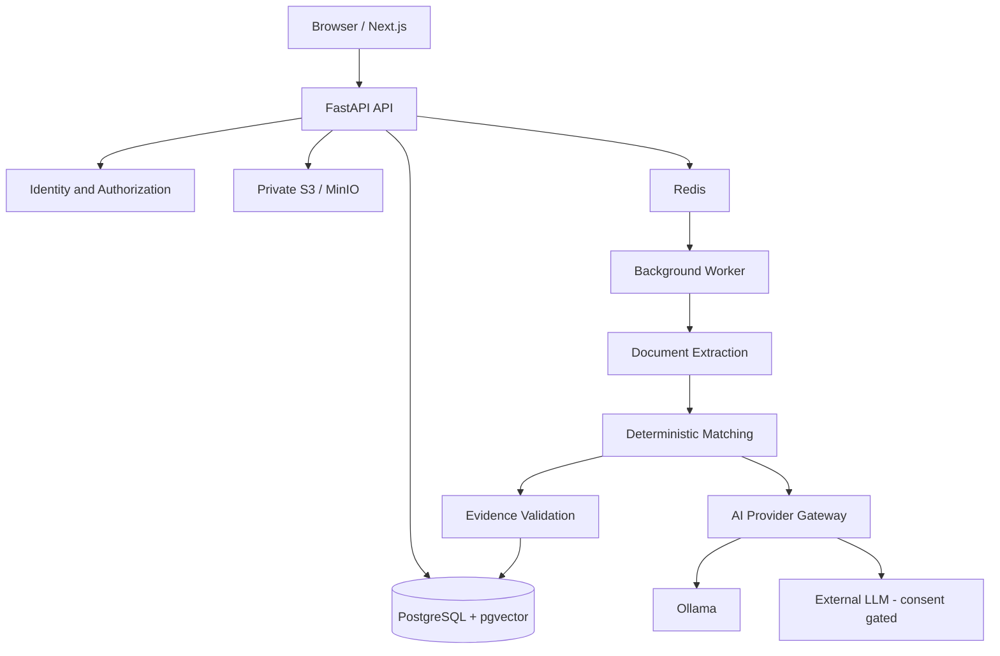

# Technical Architecture

## 1. System overview

The product is a modular monolith with separate web, API and worker processes. This keeps deployment understandable for a personal project while preserving domain boundaries for later extraction if scale requires it.

## 2. Deployment topology

### Self-hosted

Docker Compose runs web, API, worker, PostgreSQL, Redis, MinIO and optional Ollama. Bind infrastructure ports to localhost in development. Production self-hosted deployment must add TLS/reverse proxy, backups, secret management, firewalling and monitoring.

### Cloud

- Web: static/server deployment on a managed Next.js-compatible platform.
- API and worker: container runtime.
- Database: managed PostgreSQL with pgvector support.
- Queue: managed Redis-compatible service.
- Object storage: private S3-compatible bucket with provider-enforced encryption at rest. Local MinIO is a development service and does not, by itself, prove at-rest encryption; production deployment must configure and verify bucket encryption.
- Secrets: cloud secret manager.

### Hybrid AI

Local Ollama is the default route. External provider routing is disabled unless explicitly configured and consent is present for the specific purpose. Do not silently fall back from local to external inference.

## 3. Backend domains

- Identity: registration, login, token verification and account lifecycle.
- Candidate profile: structured, user-confirmed facts.
- Resume: uploads, parsing, immutable versions and exports.
- Job intelligence: job description parsing and normalized requirements.
- Matching: deterministic requirement matching and score calculation.
- Recommendations: evidence-backed suggested edits.
- Cover letters: grounded generation and editing.
- Career development: skill gap and interview preparation.
- Applications: user-managed pipeline and interview notes.
- Consent/audit: external AI permission and security-relevant events.

## 4. Data model

The initial schema is in `apps/api/migrations/0001_initial.sql`. Key relationships:

- One user owns one candidate profile and many resumes, jobs and applications.
- A resume has many immutable versions.
- An analysis binds one resume version to one job description.
- An analysis has many recommendations.
- Cover letters bind to a job and resume version where available.
- Applications can reference a job and resume version and own interview records.
- Consent records capture purpose, provider, policy version and grant/withdrawal time.

Use UUID primary keys. Use JSONB only for evolving structured extraction metadata; keep query-critical entities relational. pgvector is optional until semantic retrieval is proven useful.

## 5. Authentication and authorization

The initial API milestone uses Argon2id password hashing and short-lived signed bearer access tokens. Production must add email verification, login throttling, token/session revocation, recovery flows, and preferably secure HttpOnly cookie sessions with CSRF protection for browser use.

Every protected request derives the user ID from the verified token. The API sets transaction-local `app.user_id` for RLS. Do not accept ownership IDs from the client as authority. Use a non-superuser `career_app` DB role without `BYPASSRLS`; migrations run as the administrator. The `users` table has self-select RLS and no blanket password-hash read privilege. Login uses a narrowly scoped `SECURITY DEFINER` lookup function with a fixed search path. Registration sets the server-generated account UUID as transaction-local RLS context before inserting.

## 6. Secure document ingestion

1. Authenticated user requests an upload URL with filename, media type and expected size.
2. API validates allowed type and size, creates a random object key under the user's namespace and stores a pending resume record.
3. API returns a short-lived presigned PUT URL for a private bucket.
4. Browser uploads directly to object storage.
5. Browser calls the completion endpoint.
6. API retrieves the object with a hard byte limit, verifies actual format signature/package structure and computes SHA-256.
7. File transitions to uploaded/quarantined state; parsing is only enabled after malware scanning.
8. Worker processes the document in a sandbox and stores extracted text, section structure and source spans.

The current milestone implements steps 1–6 and persists the upload hash/status. After validation, the API writes the exact validated bytes to a separate server-controlled final key, preventing a still-valid presigned staging URL from replacing the approved object. Malware scanning and parsing remain subsequent tasks. Never treat `uploaded_pending_scan` as safe for parsing or download.

## 7. AI and scoring pipeline

1. Extract text and document structure.
2. Parse job requirements into required/preferred criteria.
3. Normalize skills using a controlled taxonomy and synonyms.
4. Match exact terms and semantic evidence separately.
5. Calculate deterministic category scores using a versioned scoring configuration.
6. Generate recommendations using the evidence set as the only factual source.
7. Validate proposed claims against evidence references.
8. Present suggestions for user approval.

A scoring report must distinguish missing evidence from missing capability. Scores are platform estimates and must not be described as a universal ATS score.

## 8. API conventions

- Prefix: `/api/v1`.
- JSON request/response contracts.
- UUID resource identifiers.
- Long-running work returns a job/resource ID and is polled or streamed via status endpoint.
- Consistent error response shape and request correlation ID.
- Pagination for collections.
- Idempotency keys for expensive create operations where retries could duplicate work.

## 9. Observability and operations

- Structured logs with request IDs, never raw document content.
- Metrics for queue depth, task latency, parser failure rate, model latency, provider selection and error rate.
- Alerts for repeated auth failures, queue backlog, storage failures and database health.
- Encrypted backups and restore drills.
- Versioned migrations applied by deployment jobs, not every API startup.

## 10. Scaling strategy

Scale vertically first. Separate worker concurrency from API concurrency. Add independent worker queues for parsing, analysis and exports if workloads diverge. Split services only when team ownership, deployment cadence or measured load justify it.
